# Sistema de Inspeção de SST — Grupo JB

Sistema web para inspeções semanais de **Saúde e Segurança do Trabalho (SST)**: preenchimento de checklists por área, registro de não conformidades com evidência fotográfica, planos de ação para tratar cada NC e relatórios prontos para impressão.

## Funcionalidades

- **Inspeções** — checklist Conforme / Não Conforme / Não se Aplica, com observação e foto para cada NC; pode ser salvo em andamento e concluído depois.
- **Modelos de checklist** — cadastro de checklists por unidade, com grupos e itens ordenados, código do documento e data de aprovação.
- **Planos de ação** — para cada NC: ação corretiva, grau de risco, responsável, prazo e status, com barra de progresso da tratativa.
- **Dashboard** — indicadores de conformidade com filtros por período, filial, área e status; resumo por filial, área e grupo do checklist.
- **Relatórios** — relatório da inspeção e do plano de ação no formato do documento oficial, com impressão / PDF (individual ou em lote).
- **Usuários** — login com senha criptografada (`password_hash`) e perfis de acesso.

## Tecnologias

PHP 8 (PDO) · MySQL / MariaDB · HTML · CSS · JavaScript

## Telas

### Login
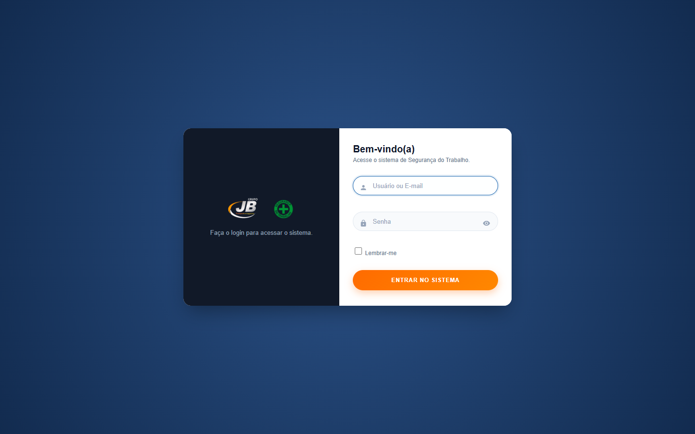

### Dashboard
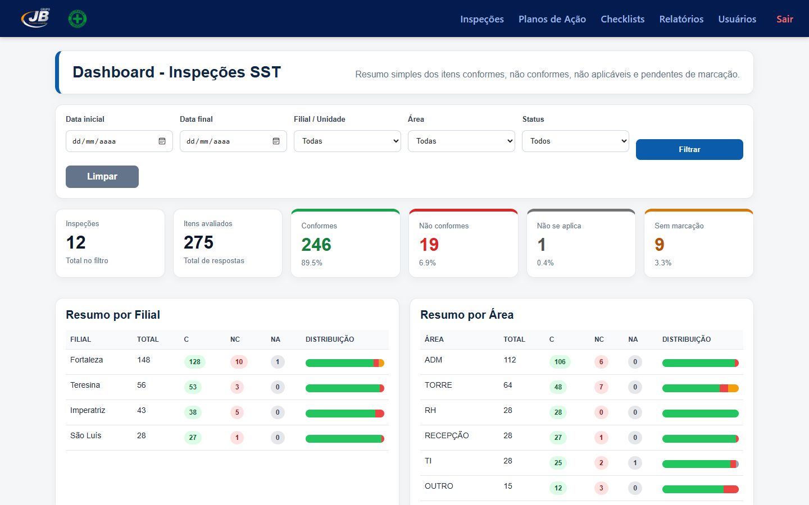

### Histórico de inspeções
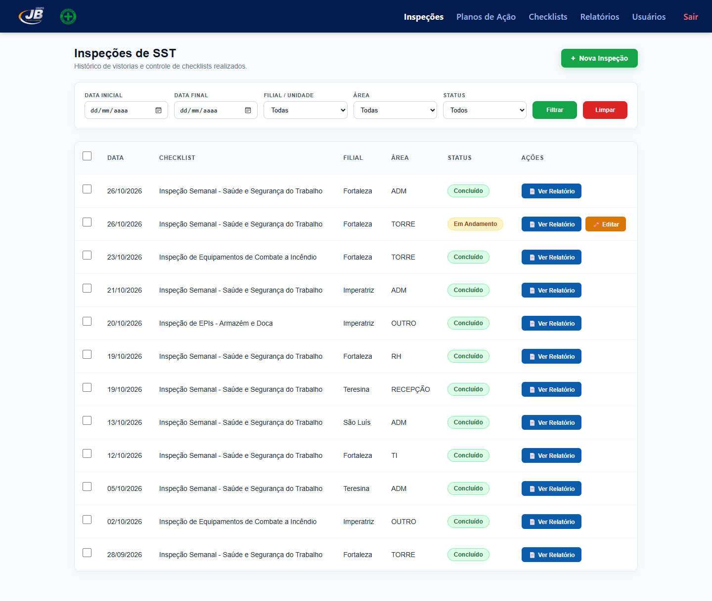

### Preenchimento do checklist (inspeção em andamento)
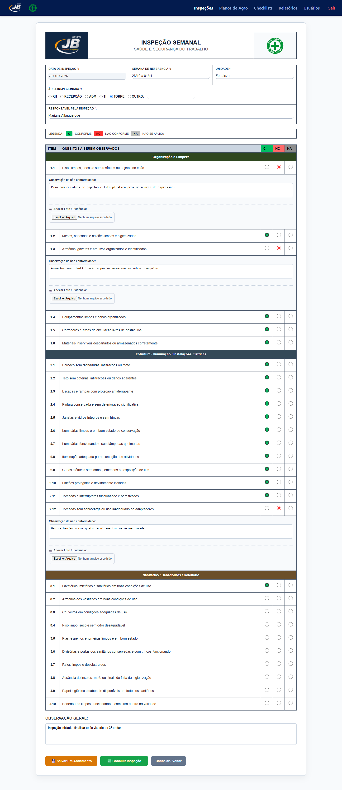

### Modelos de checklist
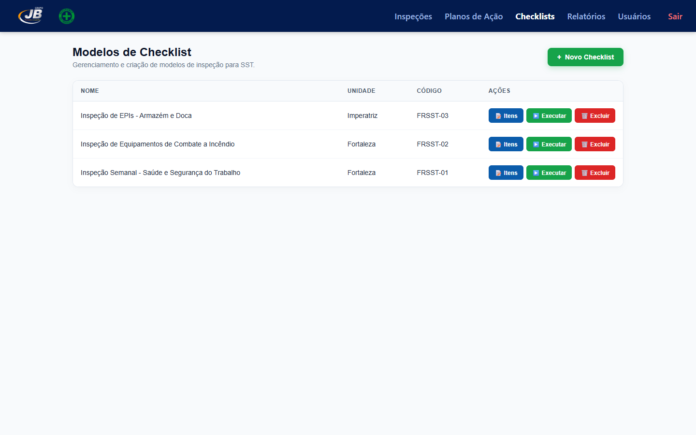

### Itens do checklist
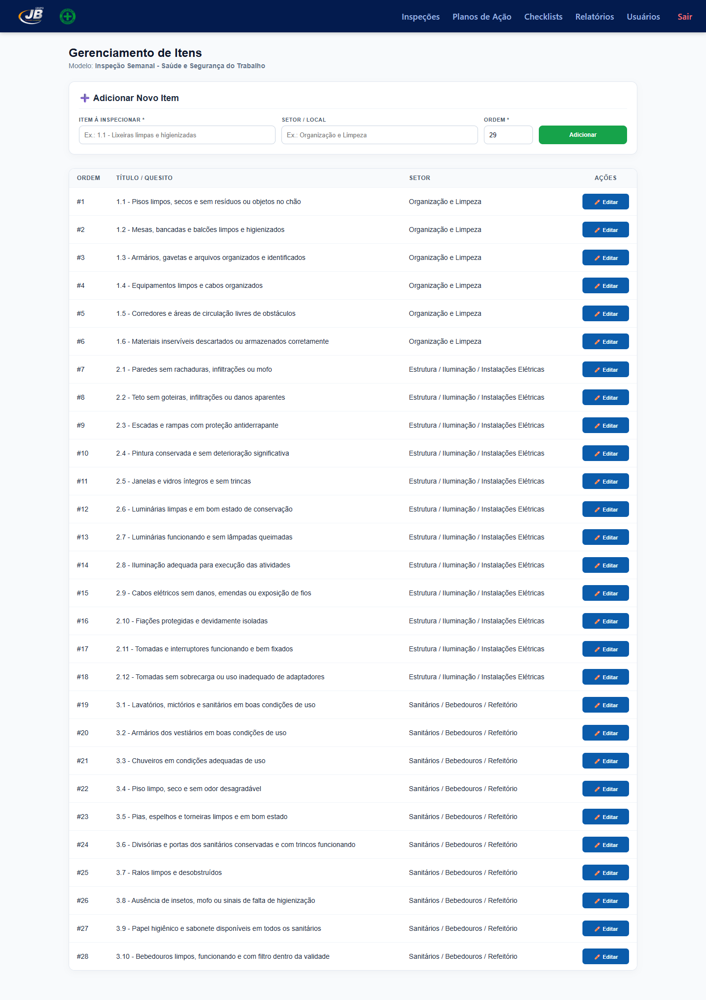

### Relatórios
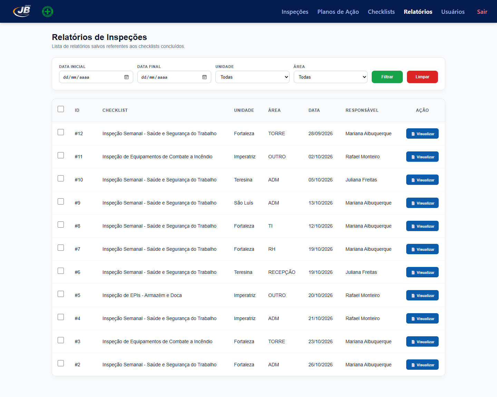

### Relatório da inspeção
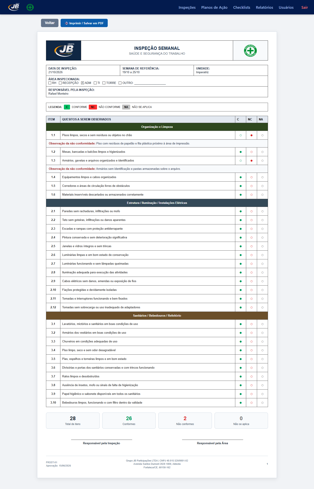

### Planos de ação
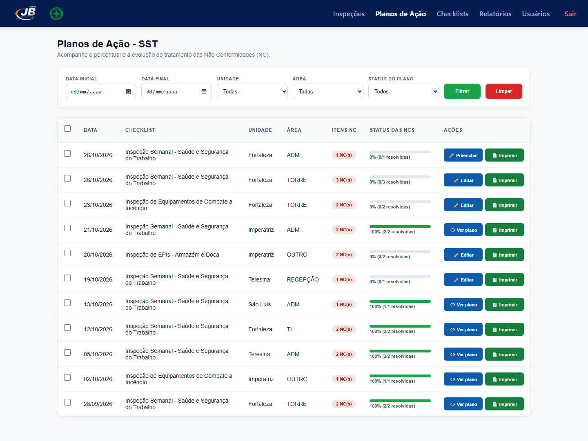

### Tratativa das não conformidades
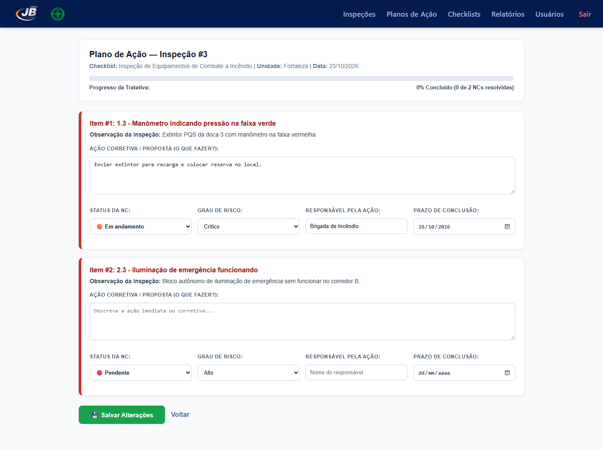

### Relatório do plano de ação
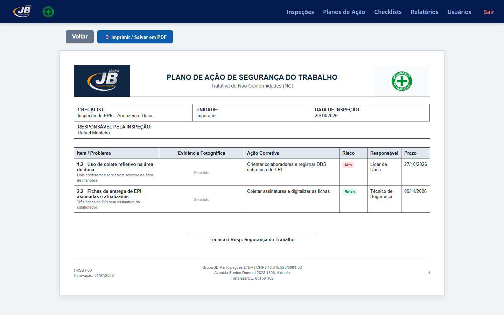

### Gestão de usuários
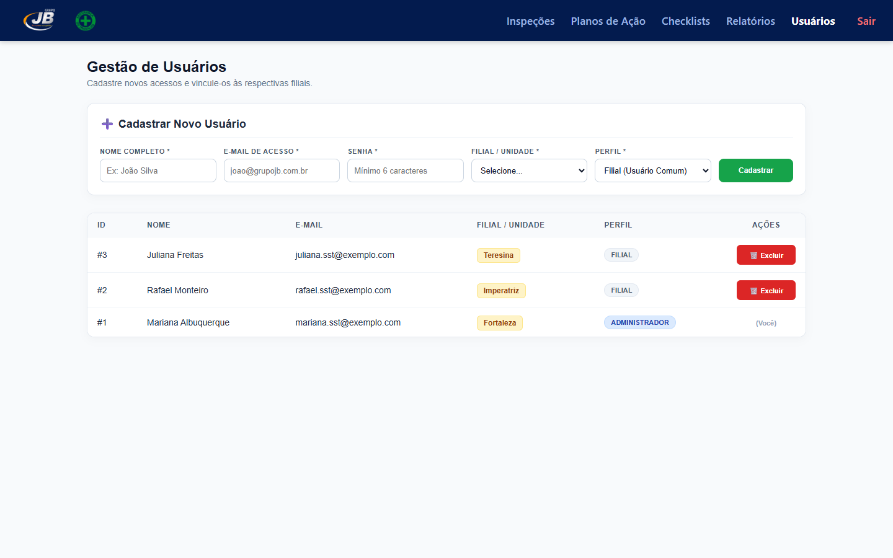

> As telas acima usam dados fictícios de demonstração.

## Como rodar localmente

1. Copie o projeto para a pasta do servidor (ex.: `C:\xampp\htdocs\sistema_inspecao_st_jb`).
2. Crie o banco `seguranca_checklist` no MySQL.
3. Copie `.env.example` para `.env` e ajuste as credenciais do banco.
4. Acesse `http://localhost/sistema_inspecao_st_jb/login.php`.
